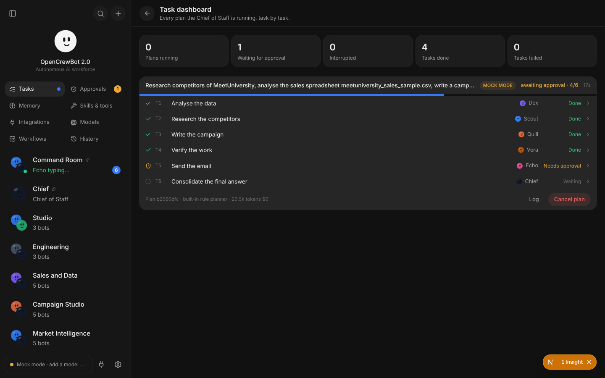

# OpenCrewBot 2.0: an autonomous AI workforce

OpenCrewBot 2.0 extends [Studio1-OSS/OpenCrewBot](https://github.com/Studio1-OSS/OpenCrewBot) (MIT) from a chat app with bots into a team that plans, delegates, uses tools, remembers, asks for approval and finishes multi-step work.

You give one instruction. A Chief of Staff agent splits it into tasks, assigns each to the agent whose tools fit, runs independent tasks in parallel, handles failures, stops for your approval before anything leaves the app, and writes one consolidated report.

> This is a fork that extends the original. The original chat, rooms, per-bot memory, Mastra harness, Browserbase browser, Composio and MCP connections are all still here and still work. The original README is kept at [docs/ORIGINAL_README.md](docs/ORIGINAL_README.md). The MIT licence is unchanged.



_Screenshots are from mock mode (no model key), which is why the plan is labelled MOCK MODE._

## What is new in 2.0

| Module | What it does | Where |
| --- | --- | --- |
| A. Chief of Staff | Understands the request, plans tasks with dependencies, picks agents, runs tasks in parallel, monitors, handles failures, consolidates | `src/lib/server/planner.ts`, `engine.ts` |
| B. Agent factory | Describe an agent in plain language; get a filled-in agent (role, persona, tools, skills, memory, permissions, output format) to review and create | `factory.ts`, New agent drawer |
| C. Multi-agent rooms | Agents delegate, ask, share findings, challenge and verify each other, with loop guards; work resumes after an interruption | `collab.ts`, `rooms.ts` |
| D. Execution engine | Visible task plan with id, agent, dependencies, status, times, output, errors, approval state; retries, timeouts, cancellation, recovery, history | `engine.ts`, Tasks page |
| E. Memory | Markdown files for agent, room, project, user preferences, decisions and work history; editable; provenance for every write | `memory-files.ts`, Memory page |
| F. Skills and tools | 12 skills loaded when a task calls for them; add your own without a restart; tool catalog with risk and live status | `skills/`, `skills.ts`, `native-tools.ts` |
| G. Permissions | Ask first, Controlled access, Full access; previews; approve or reject; tool-level permissions; audit log; cancellation; encrypted credentials | `permissions.ts`, Approvals page |
| H. Integrations | GitHub, Gmail, Slack, Notion, MCP, web search; each clearly marked live or simulated | `integrations.ts`, Integrations page |
| I. Scheduled workflows | Schedule, run now, pause, resume, run history, failure reporting | `workflows.ts`, Workflows page |
| J. Model routing | Seven providers (hosted and local), per-agent models, task-based routing, automatic fallback, token and cost tracking | `providers.ts`, `runtime.ts`, Models page |

A full comparison with the original is in [docs/FEATURE_AUDIT.md](docs/FEATURE_AUDIT.md).

## Get started

You need **Node.js 22.13 or newer** and **pnpm**.

```bash
git clone https://github.com/<your-username>/OpenCrewBot.git
cd OpenCrewBot
corepack enable            # gives you pnpm; or: npm install -g pnpm
pnpm install
cp .env.example .env       # Windows: copy .env.example .env
pnpm dev
```

Open http://localhost:3000.

**With no keys** the app runs in mock mode: the interface, planning, parallel tasks, approvals, memory, workflows and the real tools all work, but replies are scripted and labelled as mock.

**For real answers** add one free model key to `.env` and restart:

```
GROQ_API_KEY=...       # https://console.groq.com/keys
GEMINI_API_KEY=...     # https://aistudio.google.com/apikey
```

One key is enough. Two gives automatic fallback when one provider fails or is rate-limited. Everything else in `.env.example` is optional.

Keys stay in `.env` on your machine. `.env` and the `data/` folder are git-ignored. Do not commit them.

## Try it

Open **Command Room** and send one of these:

1. `Research the study-abroad market for Indian Class 11 students and our main competitors, and tell me where MeetUniversity should focus.`
2. `Create a Class 11 Aspirations campaign with a 30-day content calendar.`
3. `Analyse the sales spreadsheet meetuniversity_sales_sample.csv: where is the funnel leaking and what should we do?`
4. `Inspect the repository github.com/Studio1-OSS/OpenCrewBot and open an issue for the most important finding.` (stops for approval)
5. Workflows page → create "Competitor watch" → Run now.
6. Tell any agent `remember that I prefer answers under 100 words`, restart the app, ask `what do you remember?`. Then edit the file on the Memory page and ask again.
7. Ask for an email to be sent, press **Reject**, then open the Approvals page.

While a plan runs, send another message in the same room (for example `skip the email, and also research competitors`). The plan changes without starting over.

The full walk-through is in [docs/DEMO_SCRIPT.md](docs/DEMO_SCRIPT.md).

## The workspace

| Page | What you see |
| --- | --- |
| Chats (sidebar) | Direct messages with each agent and rooms, as in the original app |
| Tasks | Every plan: tasks, agents, dependencies, status, times, attempts, output, errors, controls |
| Approvals | Actions waiting for you with a preview, every past decision, and the audit log |
| Memory | Every memory file, an editor, and who wrote what, when and why |
| Skills & tools | The skill library, a form to add skills, data files, and the tool catalog |
| Integrations | Each service, live or simulated, with credentials and a test button |
| Models | Providers, routing, per-agent models and fallbacks, tokens and cost |
| Workflows | Scheduled instructions, run now, pause, resume, run history |
| History | All plans, saved reports and charts, recorded actions |

## Documents

- [Architecture](docs/ARCHITECTURE.md)
- [Feature audit: original vs 2.0](docs/FEATURE_AUDIT.md)
- [Live vs mocked](docs/LIVE_VS_MOCKED.md)
- [Costs, dependencies and licences](docs/COSTS_AND_LICENCES.md)
- [Known limitations](docs/LIMITATIONS.md)
- [Test evidence](docs/TEST_EVIDENCE.md)
- [Demo script](docs/DEMO_SCRIPT.md)
- [How it works, in plain words](docs/HOW_IT_WORKS.md)

## Tests

```bash
pnpm test         # 22 unit tests: permissions, approval gate, planner, data analysis, memory, skills, schedules, GitHub checks
pnpm typecheck
pnpm lint
```

End-to-end checks against a running app in mock mode (29 checks):

```bash
# terminal 1 (Windows PowerShell: $env:OPENCREWBOT_MOCK=1; $env:OPENCREWBOT_DATA_DIR="./data-test"; pnpm dev)
OPENCREWBOT_MOCK=1 OPENCREWBOT_DATA_DIR=./data-test pnpm dev
# terminal 2
node tests/e2e-mock.mjs
```

## Credits and licence

Built on [OpenCrewBot](https://github.com/Studio1-OSS/OpenCrewBot) by the Studio1 team, which is built with [Mastra](https://mastra.ai). MIT licence, retained in [LICENSE](LICENSE).
